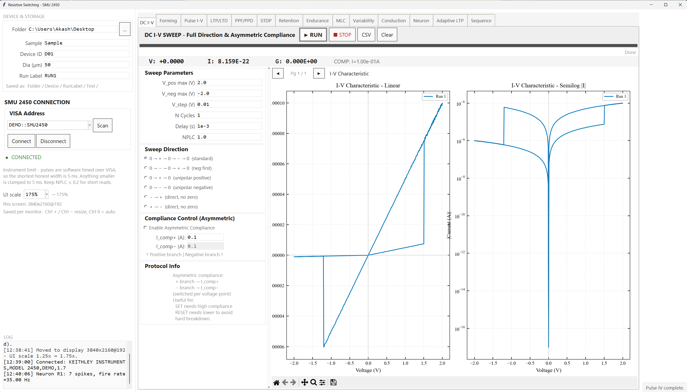

# Resistive Switching - SMU 2450


A Tkinter measurement suite for resistive-switching and neuromorphic device
characterization on a **Keithley 2450 SourceMeter**, driven over VISA.
Fourteen measurement tabs, live plots, automatic CSV/figure saving, and a
sequence runner that chains tests unattended.

## Instrument

| | |
|---|---|
| **Model** | Keithley 2450 Graphical SourceMeter® SMU (Tektronix / Keithley) |
| **Type** | 1-channel, 4-quadrant source measure unit |
| **Ratings** | 200 V, 1 A, 20 W |
| **Resolution / accuracy** | 6½-digit, 0.012 % basic measure accuracy; 20 mV and 10 nA source/measure ranges |
| **Display** | 5-inch capacitive touchscreen GUI |
| **Programming** | SCPI (native 2450 mode, 2400-compatible mode) and TSP® scripting |
| **Interfaces** | USB, GPIB, Ethernet (LXI); TSP-Link® for multi-unit setups |

The 2450 combines a power supply, true current source, 6½-digit DMM, electronic load and trigger controller in one half-rack instrument. It is aimed at scaled semiconductors, nano-scale devices and materials, organic semiconductors, printed electronics and other small-geometry, low-power devices.

**Links**
- Keithley / Tektronix product family: <https://www.tek.com/keithley>
- KickStart control software (Keithley): <https://www.tek.com/en/products/keithley/keithley-control-software-bench-instruments/kickstart>
- Tektronix software & firmware downloads: <https://www.tek.com/en/products/software>
- Datasheet and reference manual: search "2450" on the Tektronix Keithley page above.

---




*The main window: device and storage settings, instrument connection and UI
scale on the left; the selected measurement tab on the right, with its
parameter panel beside live linear and semilog I-V plots.*

---

## Requirements

| Package | Tested with | Required? |
| --- | --- | --- |
| Python | 3.11 | yes |
| tkinter | stdlib | yes |
| pyvisa | 1.16.2 | for real hardware |
| numpy | 2.4.6 | recommended |
| matplotlib | 3.11.2 | recommended |

`pyvisa`, `numpy` and `matplotlib` each degrade gracefully: without `pyvisa`
only demo mode is available, without `numpy` a small pure-Python fallback is
used, and without `matplotlib` the app runs with the plots disabled.

```bash
git clone https://github.com/akashnith/smu2450-studio.git
cd smu2450-studio
pip install -r requirements.txt
```

A VISA backend (NI-VISA or Keysight IO Libraries) must be installed separately
to talk to real hardware, or install the pure-Python `pyvisa-py` instead.

Developed and tested on Windows. It should run on Linux and macOS - only the
HiDPI scaling path is Windows-specific, and it no-ops elsewhere - but neither
has been tested.

## Running

```bash
python smu2450-studio.py
```

Pick a VISA address under **SMU 2450 Connection** and press **Connect**.
Leave the address as `DEMO::SMU2450` to run against the built-in mock
instrument - the whole UI, data saving and sequencing work without hardware,
which is the easiest way to try things out.

## Measurement tabs

| Tab | What it does |
| --- | --- |
| DC I-V | Bipolar/unipolar sweeps, six sweep directions, asymmetric compliance |
| Forming | Controlled electroforming ramp with automatic forming detection |
| Pulse I-V | Write–read and measure-during-write pulse sweeps |
| LTP / LTD | Potentiation/depression trains; four pulse schemes |
| PPF / PPD | Paired-pulse facilitation and depression vs ISI |
| STDP | Spike-timing-dependent plasticity, ΔG/G₀ vs Δt |
| Retention | Single-state, adaptive HRS+LRS, and multi-state, with KWW fitting |
| Endurance | Pulse, pulse-I-V extraction, or adaptive cycling with statistics |
| MLC | Multi-level programming plus per-state fan retention |
| Variability | Multi-device registry, D2D statistics, histograms and box plots |
| Conduction | Temperature I-V plus Schottky, Poole-Frenkel, SCLC and F-N fits |
| Neuron | Leaky integrate-and-fire emulation, EPSC/IPSC, firing rate |
| Adaptive LTP | Feedback optimizer that searches for low-nonlinearity pulse settings |
| Sequence | Chains any of the above, each with its own parameter overrides |

## Where data goes

Set the output folder, sample, device ID, diameter and run label in the left
panel. Each test writes live, row by row, so a stopped run still leaves valid
data on disk.

```
<Folder>/<Device ID>/<Run Label>/<Test>/
    Sample_D01_LTP_LTD_dia50_run003.csv
    Sample_D01_LTP_LTD_dia50_fig003.png     600 dpi
```

The sequence runner substitutes a timestamped folder for the run label, so one
sequence lands under `<Device ID>/SEQ_20260101_120000/<Test>/`. Existing files
are never overwritten - a numeric suffix is appended instead.

## Instrument limits worth knowing

The 2450 has **no hardware pulse generator** (that is the 2461). Every pulse in
this program is software timed - SCPI write, sleep, SCPI write, over VISA. Bus
round trips plus the OS sleep granularity put the shortest *trustworthy* pulse
at about **5 ms**:

- Requests below 5 ms are clamped to 5 ms, and the log says so the first time
  each value is overridden. A silently shortened pulse is how timing bugs hide.
- Keep **NPLC ≤ 0.2** for short reads. At NPLC 1 the integration alone is
  16.7 ms (60 Hz) or 20 ms (50 Hz), so a "5 ms read" is nothing of the sort.
- Genuinely sub-millisecond pulses need the 2450's TSP trigger model with
  source config lists, which keeps timing inside the instrument. That is a
  different driver architecture and is not implemented here.

## Display scaling

The UI detects the DPI of the monitor the window is actually on, not just the
primary one, and rescales live when you drag it between screens. Large
high-resolution panels get an extra readability boost on top of the OS setting.

Use the **UI scale** control in the left panel, or `Ctrl` `+` / `Ctrl` `−` to
resize and `Ctrl` `0` to return to automatic. The choice is saved **per
monitor** in `~/.smu2450_studio.json`, so a laptop panel and a desk monitor
keep their own settings. Spacing re-flows exactly on the next restart.

## Files

| File | |
| --- | --- |
| `smu2450-studio.py` | The application |
| `requirements.txt` | Python dependencies |
| `README.md` | This file |


## License

MIT. See `LICENSE`.

*Keithley, SourceMeter, TSP and TSP-Link are trademarks of Tektronix / Keithley Instruments. This project is independent and not affiliated with or endorsed by Tektronix.*
